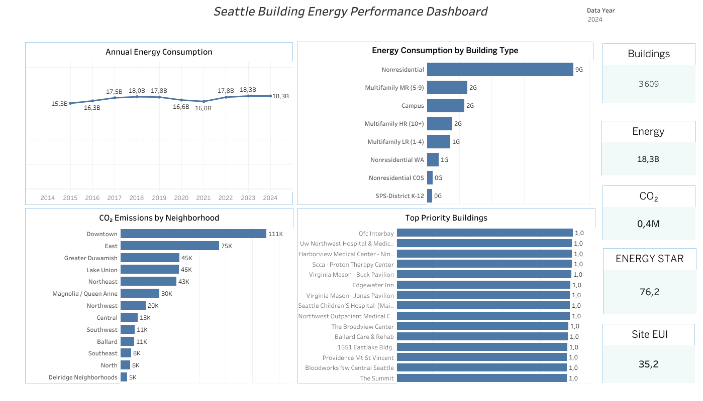

# Tableau de bord de performance energetique

Projet portfolio d'analyse de donnees sur la performance energetique des batiments.

L'objectif est de nettoyer des donnees publiques, construire des indicateurs simples et preparer un fichier exploitable dans Tableau Public.

## Presentation du projet

Ce projet transforme des donnees publiques de performance energetique en tableau de bord interactif. Il permet de suivre la consommation d'energie, les emissions de CO2, les differences entre types de batiments et les batiments a analyser en priorite.

## Objectif metier

Une equipe de gestion energetique souhaite suivre la consommation de ses batiments afin de :

- identifier les batiments les plus energivores ;
- suivre les emissions de CO2 ;
- comparer la performance par type de batiment et par quartier ;
- reperer les donnees manquantes ou incoherentes ;
- preparer un tableau de bord clair pour l'aide a la decision.

## Donnees utilisees

Source : jeu de donnees `Building Energy Benchmarking Data, 2015-Present`, publie par la Ville de Seattle sur son portail Open Data (data.seattle.gov).

Le dossier `data/` n'est pas versionne (fichiers volumineux). Pour reproduire le projet, telecharger l'export CSV du jeu de donnees et l'enregistrer ici :

`data/raw/Building_Energy_Benchmarking_Data,_2015-Present_20260704.csv`

Chaque ligne correspond a **un batiment pour une annee de declaration** : un meme batiment apparait jusqu'a 10 fois.

## Indicateurs suivis

- consommation totale d'energie ;
- intensite energetique par surface ;
- emissions totales de CO2 ;
- intensite carbone ;
- score ENERGY STAR moyen (batiments renseignes uniquement) ;
- score de priorite des batiments ;
- nombre de batiments distincts par type, quartier et statut de conformite.

## Apercu du tableau de bord



## Tableau de bord interactif

Le tableau de bord est disponible sur Tableau Public :

[Ouvrir le tableau de bord interactif](https://public.tableau.com/views/Seattle_Building_Energy_Performance_Dashboard/BuildingEnergyPerformanceDashboard?:language=fr-FR&:sid=&:redirect=auth&:display_count=n&:origin=viz_share_link)

## Analyse metier

Le jeu nettoye couvre **3 806 batiments distincts** et 33 239 declarations annuelles (2015-2024). Les chiffres ci-dessous portent sur l'annee la plus recente (2024, 3 609 batiments).

Les batiments non residentiels representent **49 % de la consommation** (environ 9,0 milliards de kBtu) et 44 % des emissions. Ils constituent donc la cible prioritaire pour les actions d'efficacite energetique. Les campus (47 sites, 12,6 % de la consommation) ont un Site EUI median deux fois superieur a celui des logements.

Les emissions de CO2 sont principalement concentrees dans Downtown (26 %), puis East (18 %), Greater Duwamish et Lake Union (11 % chacun). Ces quartiers doivent etre analyses en priorite pour les programmes de reduction carbone.

Le `priority_score` permet d'identifier, pour chaque annee, les batiments combinant forte intensite energetique, fortes emissions et faible performance ENERGY STAR. En 2024, les premiers classes sont surtout des etablissements de sante et un supermarche : ce sont des candidats prioritaires pour des audits energetiques, a comparer a des batiments de meme usage.

Le rapport complet est disponible ici : [`docs/Rapport_Analyse_Metier.pdf`](docs/Rapport_Analyse_Metier.pdf).

## Structure du projet

```text
energy-performance-dashboard/
|-- data/
|   |-- raw/        # Donnees brutes
|   |-- cleaned/    # Donnees nettoyees et exports
|-- notebooks/
|   |-- 01_data_exploration.ipynb
|   |-- 02_data_cleaning.ipynb
|   |-- 03_data_analysis.ipynb
|   |-- 04_export_tableau.ipynb
|-- src/
|   |-- indicators.py   # Indicateurs partages (dont priority_score)
|-- sql/
|   |-- create_tables.sql
|   |-- analysis_queries.sql
|-- dashboard/      # Fichier CSV pret pour le tableau de bord
|-- docs/
|   |-- Dictionnaire_Donnees.md
|   |-- Methodologie.md
|   |-- Rapport_Analyse_Metier.pdf
|-- images/
|   |-- dashboard_overview.png
|-- README.md
|-- requirements.txt
```

## Outils utilises

- Python ;
- pandas ;
- Jupyter Notebook ;
- SQL ;
- Tableau Public ;
- GitHub.

## Comment utiliser le projet

1. Installer les dependances :

```bash
pip install -r requirements.txt
```

2. Executer les notebooks dans l'ordre :

```text
01_data_exploration.ipynb
02_data_cleaning.ipynb
03_data_analysis.ipynb
04_export_tableau.ipynb
```

3. Utiliser le fichier final dans Tableau Public :

```text
dashboard/building_energy_performance_dashboard.csv
```
